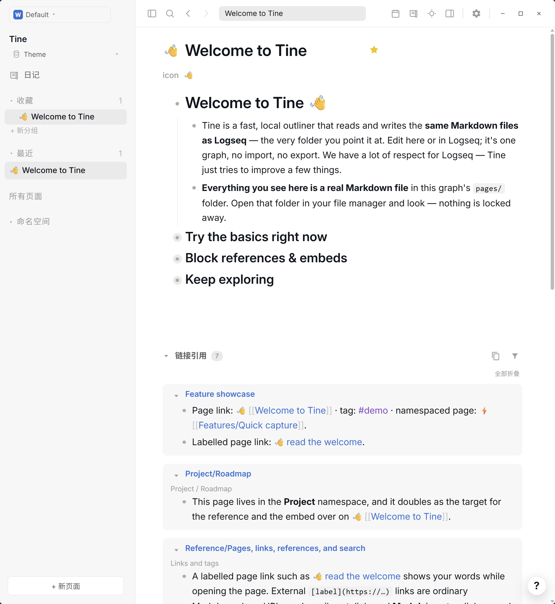

# Nord · Prism

**Polar blue-gray. Snow-colored text. A quiet place for your notes.**

[Download theme.json](https://github.com/EllisMorrow/tine-theme-nord-prism/releases/latest/download/theme.json) · [中文说明](README.zh-CN.md) · [Adaptation notes](docs/adaptation.md)

An independent **Nord** palette adaptation for Tine, and the first theme in the **Prism** collection. It pairs cool blue-gray surfaces with cyan links, violet tags and amber highlights. This package supplies colors only, leaving typography and layout to Tine and your preferences.

*Actual Tine screenshot supplied during Windows testing. The sample graph contains Tine's public welcome content.*

### Light-mode fallback

*The package supplies dark colors only. This screenshot shows Tine's light-mode fallback, not a Nord light variant.*

## Install in a minute

1. Download [theme.json](https://github.com/EllisMorrow/tine-theme-nord-prism/releases/latest/download/theme.json).
2. Open **Settings → Appearance → Theme packages → Select theme.json** in Tine.
3. Select the downloaded file, choose **Use colors**, and switch to **Dark** mode.

Requires support for **Tine Theme API 0.2**. Existing `logseq/custom.css` overrides take priority. A custom device accent may also affect accent/link appearance.

## A small palette, clear roles

| Role | Color | Purpose |
| --- | --- | --- |
| Canvas | `#2e3440` | Main reading surface |
| Sidebar | `#272c36` | A quieter frame around the page |
| Text | `#d8dee9` | Body and headings |
| Accent | `#88c0d0` | Primary accent |
| Links | `#b6d9e2` | Navigation within and beyond your notes |
| Tags | `#b48ead` | Distinct from ordinary links |
| Highlights | `#ebcb8b` on translucent amber | Marked passages |

All **21 supported color tokens** are supplied for dark mode. The package contains no scripts, custom CSS selectors, fonts, or layout presets. Search, syntax highlighting, task markers and other roles outside the package API remain host-controlled.

## What happens in light mode?

This package intentionally supplies **no light palette**. Switching to light mode uses Tine's fallback appearance, shown directly below the dark preview above. It is **not a Nord light variant**.

## Testing and scope

The manifest passed Tine's official checker. User testing supplied matching dark/light screenshots on Windows, showing headings, body text, nested outlines, links, tags, inline code, navigation and reference panels. These captures do not establish every interaction or platform as tested; highlights, text selection and settings-specific states are not shown. See [screenshot notes](docs/screenshots.md).

The earlier local CSS prototype included extra component rules. This installable package uses only the public theme API and does not claim to reproduce those unsupported rules. See [adaptation notes](docs/adaptation.md).

## Credits

- **Nord** palette by [Sven Greb / Nord](https://github.com/nordtheme/nord), used under the [MIT license](LICENSE).
- Tine adaptation and Prism packaging by **EllisMorrow**, developed with AI assistance (`aiDevelopment: primary`).
- The initial local prototype used the installed Codex Nord preset as a visual reference for surface and content roles. No Codex program code, logo or bundled assets are included.

Independent community theme; no affiliation with or endorsement by Nord or OpenAI. The upstream palette revision is recorded in `theme.json`.

## Feedback

Please [open an issue](https://github.com/EllisMorrow/tine-theme-nord-prism/issues) with your Tine version, operating system, mode and a screenshot without private note content.
