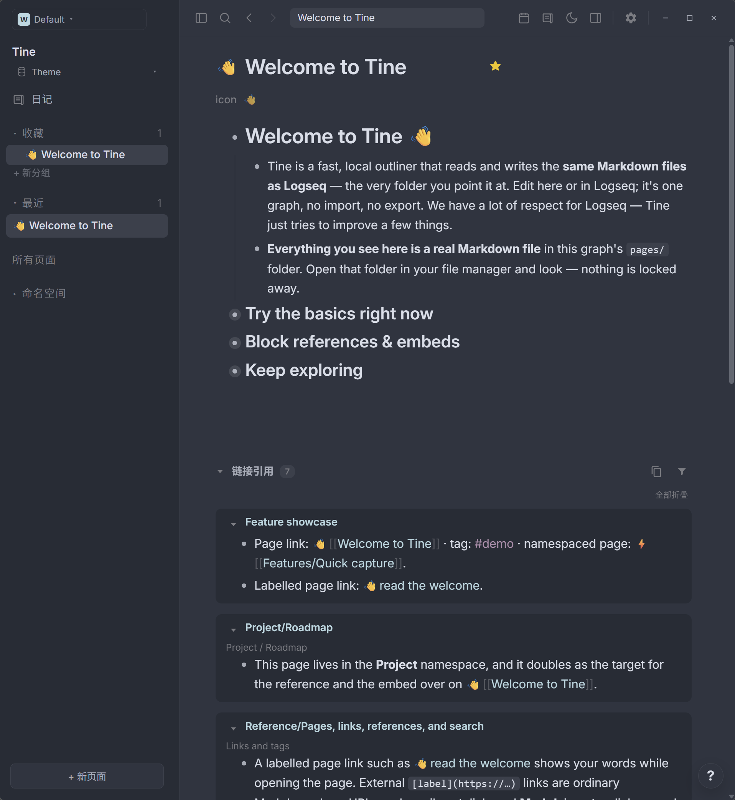
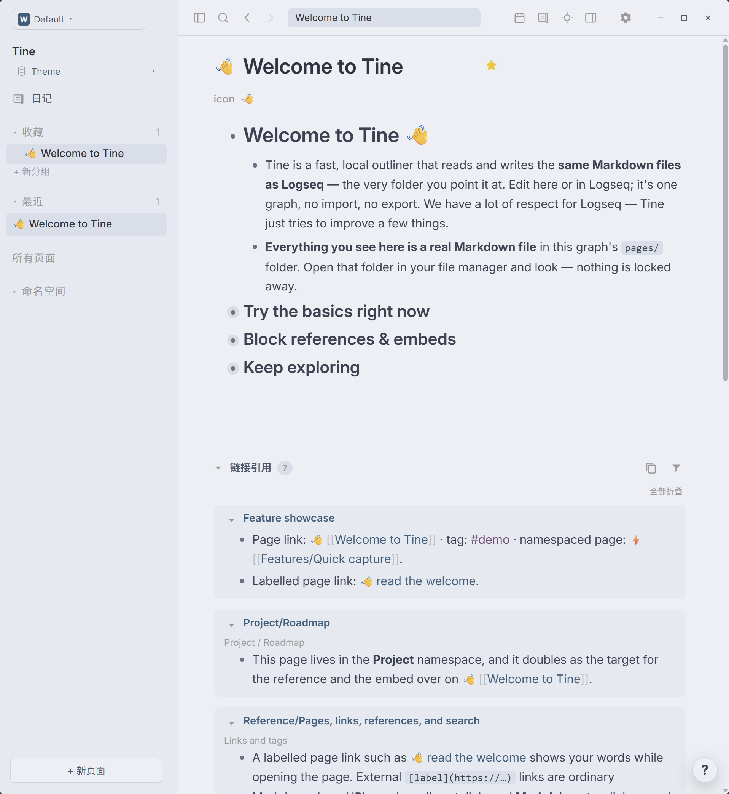

# Nord · Prism

**日间雪色、夜间蓝灰，让内容有清晰的位置。**

[English](README.md) · [下载 theme.json](https://github.com/EllisMorrow/tine-theme-nord-prism/releases/latest/download/theme.json)

Prism 系列的第一款主题，同时提供完整的浅色和深色配色：浅色采用 Nord 雪色背景、深蓝链接；深色采用蓝灰背景、青色链接。紫色标签和琥珀色高亮贯穿两种模式。只提供颜色，保留 Tine 与用户自己的字体、排版设置。

在 [Prism 主题画廊](https://github.com/martinkoutecky/tine/discussions/786)中，可以直观比较全部 29 个主题的浅色与深色效果。

### 深色模式

### 浅色模式

*这是真正包含在主题包中的浅色配色，浅色与深色通过同一个主题包切换。*

## 安装

1. 下载上方的 `theme.json`。
2. 在 Tine 中打开 **设置 → 外观 → 主题包 → 选择 theme.json**。
3. 选择文件，点击 **使用颜色**，切换至 **浅色或深色模式**。

需要支持 Tine 主题 API 0.2 的版本。图谱的 `logseq/custom.css` 仍有更高优先级；设备上的自定义强调色也可能影响强调色或链接的实际显示。

## 配色与边界

| 角色 | 浅色 | 深色 |
| --- | --- | --- |
| 主背景 | `#eceff4` | `#2e3440` |
| 侧栏 | `#e5e9f0` | `#272c36` |
| 正文 | `#3b4252` | `#d8dee9` |
| 标题 | `#2e3440` | `#d8dee9` |
| 链接 | `#355f7c` | `#b6d9e2` |
| 标签 | `#754b76` | `#b48ead` |
| 高亮底色 | `#ead6a4` | 半透明琥珀色 |

两种模式各提供全部 21 个受支持的颜色变量，切换后不依靠宿主回退配色。不包含脚本、额外 CSS、字体或布局预设。语法高亮、任务标记及其它超出主题包 API 的样式由 Tine 控制。

## 验证情况

0.2.0 已通过 Tine 官方主题格式检查；浏览器样例验证了两种完整颜色变量及浅色 → 深色 → 浅色切换。深色变量保持旧版值不变。用户安装双模式包后提供了上方两张 Windows 实机截图，展示标题、正文、层级、链接、标签、行内代码、导航与引用区域。截图未覆盖高亮、文字选中、设置状态和其它平台，不据此宣称全部路径均已验证。主题包不包含早期本地 CSS 原型中超出官方 API 的组件规则。

## 来源与许可

Nord 配色来自 [Sven Greb / Nord](https://github.com/nordtheme/nord)，遵循 [MIT 许可](LICENSE)。Tine 适配与 Prism 打包由 EllisMorrow 完成，使用 AI 辅助开发。深色原型参考了 Codex 中 Nord 预设的视觉角色；浅色为 Prism 基于 Nord Snow Storm / Polar Night 色板的自主适配，并加深蓝色、紫色文字以保持可读性，不声称是 Codex 原生浅色预设；仓库不包含 Codex 程序代码、标志或附带资源。本主题为独立社区适配，不代表 Nord 或 OpenAI 官方产品。

问题反馈请在本仓库创建 Issue，附上 Tine 版本、系统、当前模式，以及不包含私人笔记的截图。
